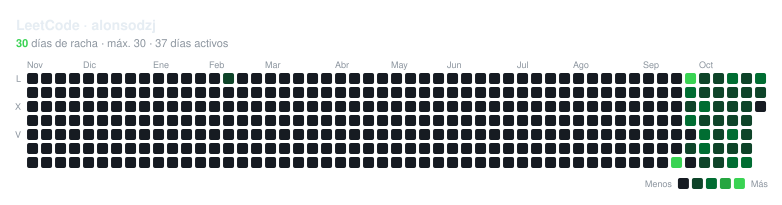

# leetcode-heatmap

SVG heatmap of your LeetCode activity for your GitHub README, regenerated daily with GitHub Actions. Fully configured from [`config.toml`](config.toml).

[](https://alonsodzj.github.io/leetcode-heatmap/)

**[Open the studio](https://alonsodzj.github.io/leetcode-heatmap/studio.html)**: try out styles, animations and effects with a live preview, and copy the resulting `config.toml`.

## Usage

1. Fork or copy this repository and change `user` (and, optionally, `lang`) in `config.toml`. You can design the style in the [studio](https://alonsodzj.github.io/leetcode-heatmap/studio.html) and paste what it exports.
2. In **Actions**, run the `heatmap` workflow (after that it runs automatically every night).
3. Add the image to your profile README:

```md
[](https://USERNAME.github.io/leetcode-heatmap/)
```

The link points to the interactive version. To publish it, enable GitHub Pages under **Settings → Pages → Deploy from a branch → `main` / root**.

### Why there are two versions

GitHub renders README images as ``, and in that context the browser doesn't run JavaScript or respond to the mouse. CSS animations (`[animation]`) do show up in the README; `[interaction]` effects only work on the page (`page = "index.html"`), when opening the SVG directly, or when embedding it in another website.

## Configuration

| Section | What it controls |
|---|---|
| `lang` | text language: `es`, `en`, `fr`, `de`, `it`, `pt`, `ca`, `ja`, or a custom one via `[locales.<code>]` |
| `[layout]` | weeks, week start, orientation, cell size and spacing, margins, scale |
| `[cell]` | shape (`square`, `rounded`, `squircle`, `circle`, `dot`, `diamond`, `hexagon`), border, empty days, today |
| `[colors]` | background or transparent, card, levels (any number), text, page background; `[colors.light]` for a light theme |
| `[thresholds]` | fixed or quantile-based thresholds |
| `[font]` | Google Fonts or a custom file (embedded in the SVG), title font, sizes, weight, spacing |
| `[title]` `[subtitle]` `[footer]` | visibility, text with variables, and alignment |
| `[months]` `[weekdays]` `[legend]` `[tooltip]` | visibility and text |
| `[animation]` | entrance (`fade`, `pop`, `rise`, `drop`, `spin`) or loop (`wave`, `sparkle`), order, timing, heartbeat on today or the streak |
| `[interaction]` | CSS hover and pointer effects: `gravity`, `repel`, `magnify`, focus, crosshair, same level, ripple on click |

Variables available in text: `{user}` `{streak}` `{max_streak}` `{active_days}` `{total}` `{best_day}` `{today_count}` `{updated}` `{weeks}`; the tooltip also supports `{count}` `{date}`. Text wrapped in `**double asterisks**` uses the accent color.

Text is taken from the selected language; anything you write in `config.toml` takes priority. Each `[[output]]` block generates a separate file inheriting the base configuration, and can have its own `lang`.

### Pointer effects

Hovering doesn't show any information, only the animation. Cells move and scale with a damped spring, but each one is confined to its own grid slot, so they never overlap. `shrink` makes them shrink as the pointer approaches to leave more room to move, and `strength`, `stiffness` and `damping` tune the intensity and bounce. When `prefers-reduced-motion` is enabled on the system, motion is disabled.

## Development

```bash
python generate.py --sample --outdir build   # random data, offline
python generate.py                           # real data
```

Python 3.11 or later, no dependencies.

```
generate.py          command-line interface
heatmap/
  config.py          defaults and TOML loading
  locales.py         per-language text
  data.py            LeetCode API, streaks and thresholds
  render.py          SVG and page rendering
  shapes.py          cell shapes
  motion.py          CSS animations
  fonts.py           font embedding
  interact.js        pointer effects
studio.html          visual configurator (published with GitHub Pages)
```

`studio.html` replicates the `heatmap/` renderer in JavaScript for the preview. If you change options or defaults in Python, update them there too.

## License

[MIT](LICENSE)